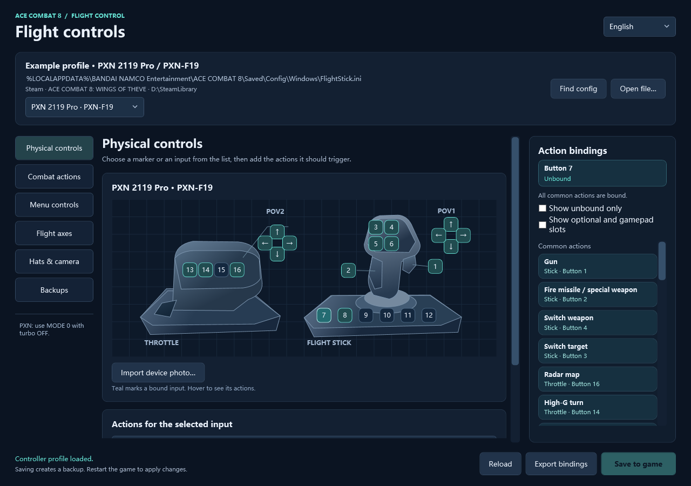

# ACE COMBAT 8 Flight Controls

[简体中文](docs/user-guide.md) · [日本語](docs/user-guide.ja.md)

A Windows editor for ACE COMBAT 8 flight-stick bindings. Hover over a marker to see its actions, or select it to pin its bindings beside the diagram. The action list shows every input for each common action and highlights gaps. Optional actions and generic gamepad slots are available through a separate filter.



## Quick start

1. Connect your controller and launch the game once so it creates its profile. Exit the game before editing.
2. Run `AceCombat8Keybinds.exe`. Let it find `FlightStick.ini` through Steam and the Windows user profile, or open the file manually.
3. Select a device. Click a control marker, choose an action, and select **Add binding**. Repeat with another control to give the same action a second input.
4. Review the pending changes and the unbound-action badges. Select **Save to game**, then restart the game. Saving creates a backup next to the configuration.

The app offers English, Simplified Chinese, and Japanese. It starts in the Windows display language when supported, and remembers your choice.

## Controllers and long presses

The PXN 2119 Pro has a built-in stick and throttle schematic with clickable markers. Other controllers use the device profiles already present in the game's file. Connected DirectInput devices are matched by product ID to identify their controls. For a custom visual layout, import a photo, choose an input, and place its marker on the photo.

Actual game support depends on the controller, its mode, and the installed game build. See the hardware references, verification status, and [research on other games](docs/compatibility.md).

ACE COMBAT 8 represents **tap to switch target / hold to look at the target** as the same native action. You can add a second button for that action. Both buttons inherit the tap and hold behavior. The game file exposes no separate hold-only slot for target look or cutscene skip.

## Build and run

Use Windows x64 and .NET SDK 9.0.203.

```powershell
dotnet run --project src/AceCombat8.Desktop/AceCombat8.Desktop.csproj -c Release
dotnet run --project tests/AceCombat8.Tests/AceCombat8.Tests.csproj -c Release
.\tools\build.ps1
```

The build script produces a portable folder under `artifacts/release` with its own runtime. Keep the executable and the rest of that folder together. [Build, test, and screenshot instructions](docs/development.md)
