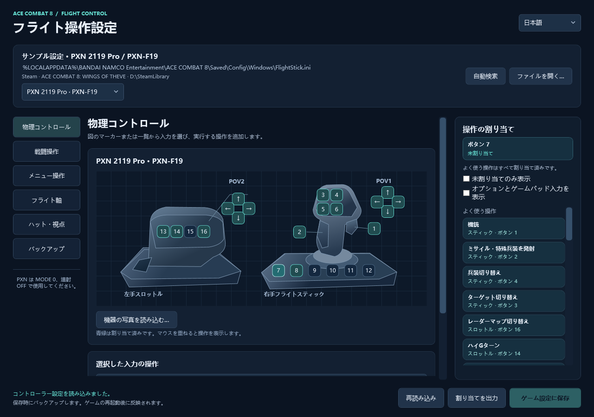

# ACE COMBAT 8 フライト操作設定

[English](../README.md) · [简体中文](user-guide.md)

Windows 用のフライトコントローラー設定ツールです。言語は右上のメニューで切り替えられます。

1. コントローラーを接続してゲームを一度起動し、終了します。
2. `AceCombat8Keybinds.exe` を開きます。自動検索で設定が見つからない場合は、`FlightStick.ini` を選択します。
3. 機器を選択し、**物理コントロール** で図のマーカーまたは一覧から入力を選びます。操作を選んで **割り当てを追加** を押します。
4. 同じ操作に別のボタンを登録するには、そのボタンを選んで同じ操作を追加します。解除は **この入力を解除** から行います。
5. 右側の一覧で割り当てと未保存の変更を確認し、**ゲーム設定に保存** を押してゲームを再起動します。

マーカーにマウスを重ねると割り当てを確認できます。選択した入力の操作は右上に固定表示されます。よく使う操作の未割り当てはオレンジ色で表示され、そのまま保存できます。オプションやゲームパッド入力は別のフィルターで表示できます。

PXN 2119 Pro にはスティックとスロットルの図が付属します。他の機器では、ゲームが作成した機器設定を選び、DirectInput の番号で編集できます。写真を読み込み、入力を選んで写真上にマーカーを配置することもできます。

ターゲットの切り替えと長押し注視は、ゲーム内では同じ操作です。ボタンを追加すると両方の挙動が使えます。注視やムービースキップの長押しだけを別のボタンに割り当てる設定は確認できていません。

保存時に元の設定をバックアップします。**バックアップ** 画面で過去の設定をプレビューしてから、選択中の機器に復元できます。

詳しい対応条件は [互換性の調査結果](compatibility.md) を参照してください。
