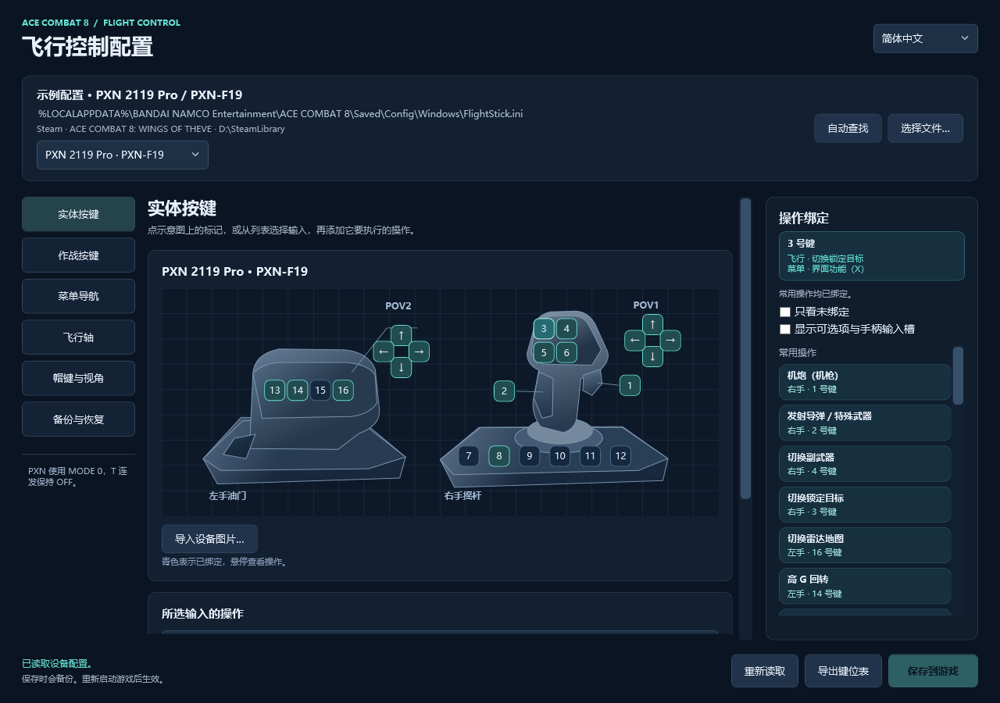
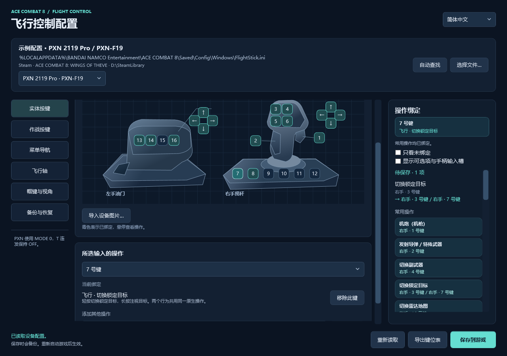
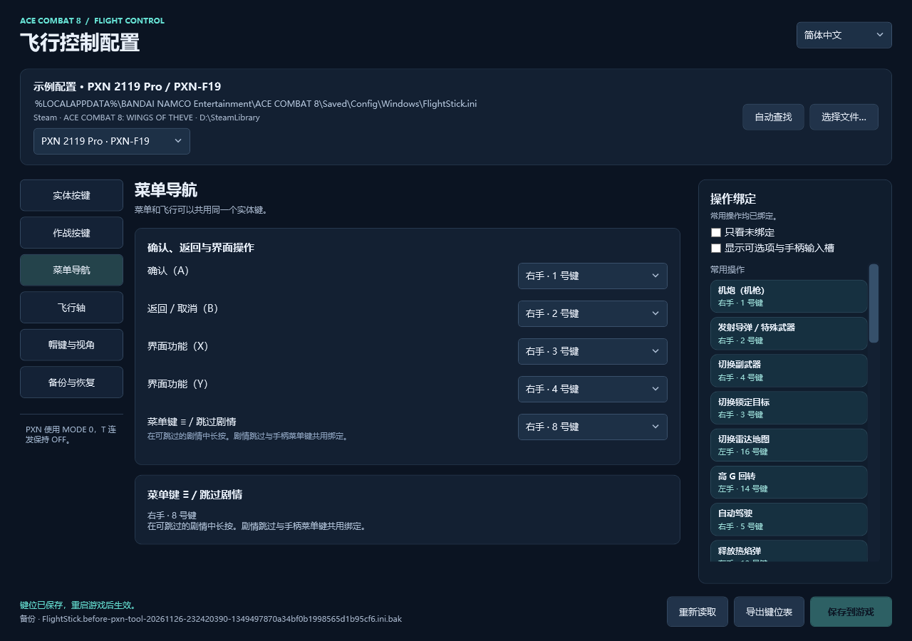
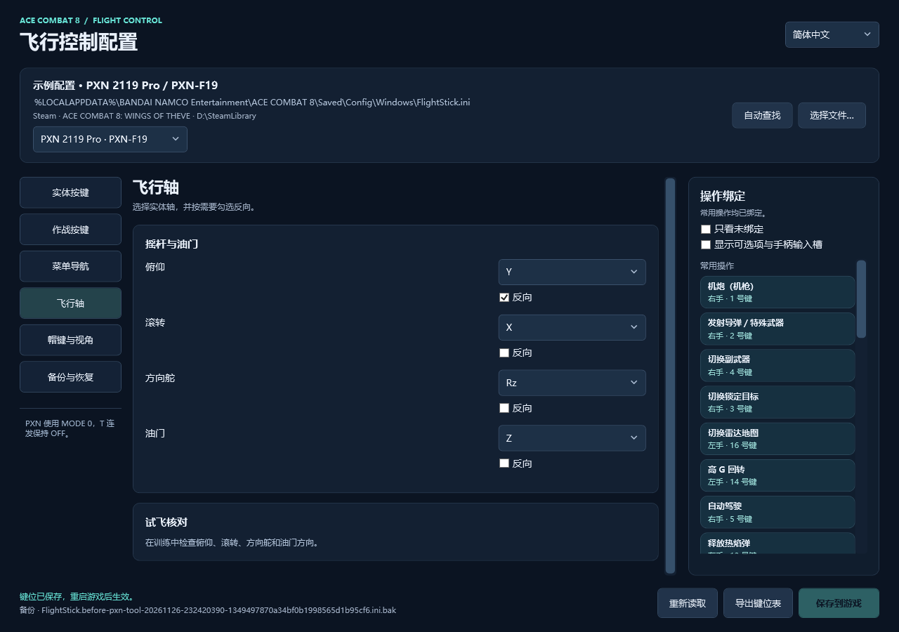
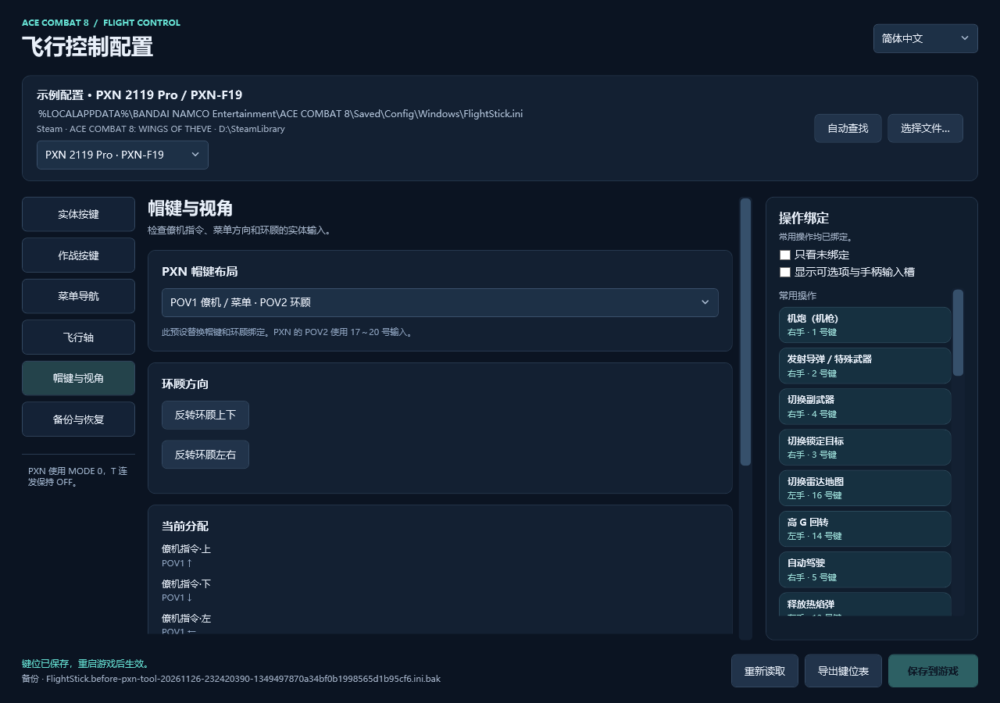
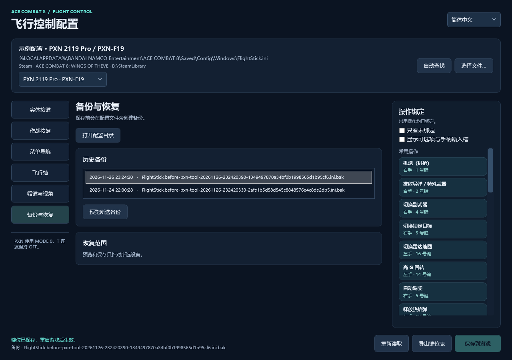

# 皇牌空战8 PXN 键位工具 · 图文使用说明

[English](../README.md) · [日本語](user-guide.ja.md)

适用于 Windows x64。本文对应 1.1.1 版。右上角可切换简体中文、English 和日本語。截图使用示例配置，路径与键位以实际界面为准。

## 1. 打开工具，定位游戏配置

运行便携目录中的 `AceCombat8Keybinds.exe`，或使用桌面快捷方式。便携版已包含所需运行库；移动时请保留整个目录，包括配套文件和 `runtime` 子目录。

工具自动读取 Steam 路径、游戏库和《皇牌空战8》安装清单，再验证当前 Windows 用户的摇杆配置。找到一个有效文件时自动读取；找到多个时由你选择。



自动查找失败时，点右上角 **选择文件…**，选择 `FlightStick.ini`。常用位置：

```text
%LOCALAPPDATA%\BANDAI NAMCO Entertainment\ACE COMBAT 8\Saved\Config\Windows\FlightStick.ini
```

将目录粘贴到资源管理器地址栏即可定位。工具也会检查 `WindowsNoEditor` 备用目录。文件尚未生成时，连接摇杆和油门，启动一次游戏后退出，再点 **自动查找**。

## 2. 从实体键添加操作，核对后保存

在 **实体按键** 中点击图上的标记，或通过下拉框选择按键、帽键或轴。选择游戏操作后点 **添加绑定**。同一个操作可以添加多个输入，例如保留 3 号键切换目标，再给 7 号键添加同一个操作。点击 **移除此键** 只解除当前输入。

示意图上青色表示已绑定，悬停可查看操作。点击编号后，右侧顶部固定显示该键的当前绑定。在下方 **当前绑定** 可移除已有操作，**添加其他操作** 的下拉框用于新增。

右侧气泡列出每个常用操作的输入，缺项以橙色标出。可勾选 **只看未绑定**，也可显示可选项与手柄输入槽。左肩键、扳机和触摸板是游戏配置接受的手柄输入名称，其效果由具体场景决定。它们和其他可选项目不计入常用操作的缺项提示。

PXN 2119 Pro 的专用图中，1～12 号键在摇杆侧，13～16 号键在油门侧。其它设备使用游戏配置中已有的设备区段，按 DirectInput 编号编辑。也可 **导入设备图片**，选择实体输入，再用 **在图上放置所选输入** 把标记放到对应位置。设备和游戏的支持范围见 [兼容性调研](compatibility.md)。

**作战按键** 页提供 PXN 常用布局。

| 实体键 | 游戏功能 | 使用方式 |
| --- | --- | --- |
| 1 号键 | 机炮（机枪） | 按住持续射击 |
| 2 号键 | 发射导弹／特殊武器 | 发射当前选中的武器 |
| 3 号键 | 切换锁定目标 | 长按注视当前目标 |
| 4 号键 | 切换副武器 | 在标准导弹与特殊武器之间切换 |

修改后，右侧显示待保存的变化。下图给切换锁定目标增加第二个实体键，原来的键也能使用。



确认后点右下角 **保存到游戏**。底部显示保存结果和备份文件名后，重新启动游戏，在训练中试用。

同一场景中多个功能共用输入时，工具会提示可能同时触发；有意共用时仍可保存。菜单和飞行分别检查，合法的跨场景共用不会被视为冲突。

点 **重新读取**可读取磁盘上的最新配置。有尚未保存的更改时，工具会先询问是否放弃。

## 3. 菜单导航与长按跳过剧情

**菜单导航**单独调整确认 A、返回／取消 B、界面功能 X/Y，以及 **菜单键 ≡／跳过剧情**。菜单方向跟随负责僚机指令的帽键。



当前布局中，**右手 8 号键**同时绑定飞行“暂停”和手柄三横线“菜单键（≡）”。在支持跳过的剧情中，按住菜单键使用跳过功能。暂停与菜单键分别绑定，修改其中一个不会自动修改另一个。

键盘 Esc 保留游戏原有功能。8 号键的原生映射已核对，具体剧情内的跳过效果仍需试用确认。

切换锁定目标和长按注视目标共用游戏中的同一个操作。第二个键也会同时获得短按和长按行为。目前的原生文件没有单独绑定“注视目标”或“长按跳过剧情”的配置。

## 4. 飞行轴与反向

在 **飞行轴** 页面选择实体轴，并按实际操作方向勾选反向。



| 游戏功能 | 当前常用实体轴 | 方向 |
| --- | --- | --- |
| 俯仰 | 右手前后推杆 Y | 反向：后拉抬头、前推低头 |
| 滚转 | 右手左右推杆 X | 标准 |
| 方向舵 | 扭转握把 Rz | 标准 |
| 油门 | 左手油门推杆 Z | 标准 |

也可选择 RX、RY 旋钮或底座滑块。调整后保存，重新启动游戏，在训练中检查方向和行程。

## 5. POV1、POV2 与环顾

PXN 2119 Pro 可在 **帽键与视角** 中选择分工。

- **右手 POV1：僚机／菜单，左手 POV2：环顾**，这是当前常用布局。
- **右手 POV1：环顾，左手 POV2：僚机／菜单**，用于对调两侧功能。



切换分工会一起更新僚机、菜单方向和环顾绑定。也可以分别反转环顾上下、左右方向；下方“当前分配”列出实际输入。

这台设备的 POV2 原生输出是 **17～20 号输入**。工具已内置正确映射，不占用 9～12 号实体键，也不需要改变驱动映射。

环顾与自动驾驶使用按住操作。请使用 **MODE 0**，并在 PXN 软件中将对应按键和帽键的 **T 连发设为 OFF**，否则长按会变成连续点按。

## 6. 备份与恢复

每次保存前，工具都会在当前配置同一目录保留完整原始备份，文件名形如 `FlightStick.before-pxn-tool-时间-唯一编号.ini.bak`。



恢复步骤：

1. 打开 **备份与恢复**，选中一个历史版本。
2. 点 **载入选中备份，先预览**，此时不会写入游戏。
3. 核对右侧的更改。
4. 点 **保存到游戏**，再重新启动游戏。

恢复只应用到选定的设备。保存前会再次备份当前版本。和同一设备匹配的 `.ini.bak` 历史备份也能读取。

点 **打开配置文件所在文件夹**，可在资源管理器中查看配置和备份。

## 7. 导出到 Obsidian

点底部 **导出键位表**，选择 `.md` 保存位置，再放入你的 Obsidian 笔记库。导出包含作战、菜单、控制轴和帽键的当前分配。

导出采用当前界面中的绑定；如果仍有“待保存的更改”，还需另点 **保存到游戏**才能应用。

## 常见问题

| 现象 | 处理方式 |
| --- | --- |
| 找不到配置 | 连接摇杆后启动一次游戏并退出，再查找；或手动选择 FlightStick.ini |
| 没有目标设备区段 | 检查摇杆是否在 PC 模式、游戏能否识别设备，退出游戏后再次打开配置 |
| 保存时提示游戏正在运行 | 完全退出游戏后再保存 |
| 提示配置被其他程序修改 | 重新读取，再调整保存；工具没有覆盖外部改动 |
| 修改后游戏没有变化 | 确认文件路径正确，完全退出并重新启动游戏 |
| 环顾抖动、自动驾驶长按断续 | 检查 T 连发为 OFF、MODE 为 0，并在 PXN 软件中应用 |
| 确认和机炮共用 1 号键 | 两者属于不同场景，是正常布局 |
| 想跳过剧情 | 当前菜单键为右手 8 号键，在可跳过的剧情中长按试用 |

六张图片均由工具自身使用示例配置渲染，采用通用路径，不包含私人桌面、账号或本机用户名。
